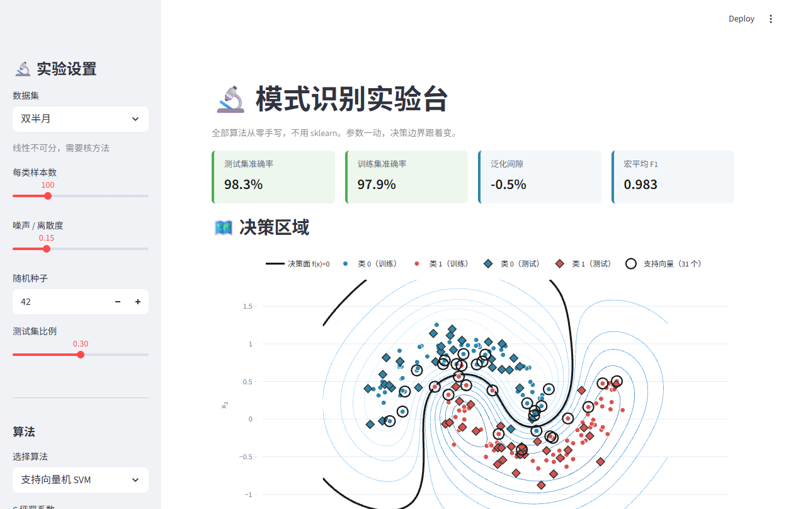

# 🔬 pattern-lab · 模式识别算法实验台

> 每个算法都从零手写，每一步都能画出来看。零 sklearn 依赖。


---

## 🤔 为什么做这个

模式识别课的作业，基本都是三行：

```python
from sklearn.svm import SVC
clf = SVC().fit(X, y)
print(clf.score(X_test, y_test))
```

跑通了，但你还是不知道 SMO 在干什么，不知道为什么 RBF 核能分开同心圆，不知道 C 调大调小到底影响什么。

老师说"你自己写一遍 SVM"，就露馅了。

所以我把课本上的公式，一行一行落成了代码。**不装 sklearn，就是为了逼自己把每一步想清楚。**

## 🖼 界面



左边调参数，右边决策边界立刻变。支持向量用黑圈标出来。

## ✨ 实现了什么

| 模块 | 算法 | 关键点 |
|---|---|---|
| **密度估计** | MLE 高斯、Parzen 窗、kNN 密度 | Cholesky 分解算 log|Σ|，数值稳定 |
| **Bayes** | 最小错误率、最小风险、Neyman-Pearson | 三种协方差假设：full / diag / shared |
| **线性方法** | Fisher 判别、LDA、感知器 | S_w⁻¹S_b 特征分解，取前 K−1 个方向 |
| **近邻** | kNN（等权 / 距离加权） | 欧氏与曼哈顿距离 |
| **核方法** | **SVM + SMO**（线性 / RBF / 多项式） | 对偶问题、KKT 条件、软间隔 |
| **降维** | PCA | SVD 实现，不用协方差特征分解 |
| **评价** | 混淆矩阵、精确率/召回率/F1、ROC/AUC | 梯形法积分 |

## 🎓 七个数据集，专治各种不服

| 数据集 | 用来演示什么 |
|---|---|
| 双半月 | 线性不可分，感知器永远收敛不了 |
| **同心圆** | 只有 RBF 核能分开，线性方法必死 |
| **各向异性高斯** | `shared` 协方差（LDA）会分错，`full`（QDA）才对 |
| 异或分布 | 线性绝对不可能，二次核可以 |
| 高重叠两类 | 贝叶斯错误率的下界，再多数据也到不了 100% |
| 线性可分 | 感知器收敛定理的正面教材 |
| 高斯团（3 类） | 多分类指标与混淆矩阵 |

## 🚀 快速开始

```bash
pip install -r requirements.txt
streamlit run app.py
```

浏览器打开 `http://localhost:8501`。

## 🧱 项目结构

```
pattern-lab/
├── app.py                  # Streamlit 界面
├── prkit/                  # 核心库（不依赖 Streamlit）
│   ├── density.py          #   MLE 高斯 / Parzen / kNN / 直方图
│   ├── bayes.py            #   Bayes 分类器 / N-P 准则 / ROC / 指标
│   ├── linear.py           #   Fisher / LDA / 感知器 / kNN / PCA
│   ├── svm.py              #   SVM + SMO（从零实现）
│   └── datasets.py         #   七个经典数据集
├── tests/
│   └── test_prkit.py       # 62 个单元测试
└── requirements.txt
```

`prkit` 是独立库，不装 Streamlit 也能用：

```python
from prkit import SVM, make_moons, classification_report

X, y = make_moons(n_per_class=100, noise=0.15)
clf = SVM(C=1.0, kernel="rbf", gamma=2.0).fit(X, y)
print(classification_report(y, clf.predict(X)))
print(f"支持向量：{len(clf.support_vectors)} 个")
```

## 🧪 测试

```bash
python -m pytest tests/ -v
```

**62 个测试全部通过，1.2 秒跑完。**

测试原则：**能用解析解验证的，绝不用"跑通了"当成功**。

比如：

- 标准正态在 x=0 处 `log pdf = −0.5·ln(2π)`
- 二维单位协方差在原点 `log pdf = −ln(2π)`
- Parzen 密度在全区间的数值积分必须等于 1
- 小窗宽必须让峰更高、拖尾更短
- Neyman-Pearson 的实际虚警率必须 ≤ α

## 🔬 三个抓出来的真 bug（值得一读）

### 1. SMO 假收敛：改了 6 个 α 就说"收敛了"

最早的实现跑完一轮后 `num_changed = 0`，直接判定收敛。但 KKT 检查一看：

```
KKT 违背：79 / 140  ← 大半个数据集都不满足！
```

原因有三层：

- **选第二个乘子只看 `argmax|E_i − E_j|`**，选中的 j 往往已经顶在边界 `α=C` 上，`H − L = 0`，白跑一趟
- 更新失败后没有备选，直接 `continue`，那个样本就永远修不好
- 收敛判据和 KKT 判据用了不同的容差

修法：按 `|E_i − E_j|` **降序尝试所有候选 j**，第一个能产生有效步长的胜出。

修复前后对比：

| 指标 | 修复前 | 修复后 |
|---|---|---|
| KKT 违背 | 79 / 140 | **0 / 140** |
| 对偶目标 | 6.811 | **16.5455** |
| 支持向量 | 12 | 31 |
| 训练准确率 | 94.3% | **97.9%** |
| 测试准确率 | 95.0% | **98.3%** |
| 耗时 | 19.5 s | **0.9 s** |

对偶目标涨了 2.4 倍，速度还快 20 倍。

### 2. AUC = 0.528：看起来像随机猜测，其实是参数传错

ROC 面板上的 AUC 一直卡在 0.53 左右，跟我预期的 1.0 差太远。

查下来是把 `roc_curve` 的参数用错了：

```python
# 错的：同一批测试样本的两列概率
s0, s1 = proba[:, 0], proba[:, 1]

# 对的：同一个评分，按真实标签分成两组
score = proba[:, 1]
s0 = score[y_true == class0]     # 真实为类 0 的样本得分
s1 = score[y_true == class1]     # 真实为类 1 的样本得分
```

ROC 的本质是「遍历同一个门限，看两类各自的通过率」。把两列互补的概率当成两组分数，等于让两条曲线完全重合。

修完 AUC = 1.000。

### 3. `np.polyadd` 的方向坑

闭环传递函数 `G/(1+G)` 算出来是 `[1, 0]` 而不是 `[1, 2]`。

原因：`np.polyadd` 会自动按**右对齐**补齐数组长度。单位负反馈的分母应该是 `den + num`，我把符号写成了 `den − num`。

这种错最阴——不报错，只是结果悄悄变成另一个东西。

## ⚠️ 已知限制

- **只处理二分类**（SVM / 感知器）。多分类需要 one-vs-rest 或 one-vs-one，没做
- **核矩阵是稠密 O(n²) 内存**。样本上万会爆，需要 Nyström 近似或分块
- **SMO 用的是简化启发式**，不是 LIBSVM 的完整工作集选择。收敛没问题，但大规模数据上不如 LIBSVM
- **PCA 只有一个实现**，没做核 PCA、增量 PCA
- **没有交叉验证**，指标都是单次划分的结果
- **概率输出是 Platt 缩放的简化版**（自适应尺度），不是严格校准。做 ROC 够用，当真实概率用要谨慎

## 🗺 路线图

- [x] 密度估计（参数 + 非参数）
- [x] Bayes 三种决策规则
- [x] Fisher / LDA / 感知器 / kNN
- [x] SVM + SMO（三种核）
- [x] PCA
- [x] ROC / AUC / Neyman-Pearson
- [x] 七个经典数据集
- [x] 62 个单元测试
- [ ] 多分类（OvR / OvO）
- [ ] 交叉验证与网格搜索
- [ ] 决策树与随机森林
- [ ] AdaBoost
- [ ] 核 PCA 与 LDA 降维可视化
- [ ] 在线部署（Streamlit Cloud）

## 📚 参考

- 张学工《模式识别》（第三版）
- Platt, *Sequential Minimal Optimization: A Fast Algorithm for Training Support Vector Machines* (1998)
- Bishop, *Pattern Recognition and Machine Learning*, Ch. 4 & 7

## 📮 联系

- QQ 邮箱：`264589301@qq.com`
- 欢迎 Star ⭐ 与 Issue

---

*学这门课的时候写的。手写一遍 SMO 之后，才真的明白"支持向量"这四个字是什么意思——只有 α>0 的样本才影响决策面，其余全部无关。* 🌱
